# 试作 · TRY

制作：**藤野京**

每件作品都是**一个独立的 `.html` 文件**：字体、程序、数据全部封装在里面，下载这一个文件、双击即可在浏览器中离线打开，无需安装、无需联网。

| 作品 | 简介 |
|---|---|
| [**无尽藏**](无尽藏.html) | 一叶扁舟自白帝城顺江东下，三千九百六十里直至东海。「古今」里沿江的历史与神话在雾中浮现，「四时」随季节晨昏雨雪而变；可垂钓、集诗、钤印。单个文件，离线可玩。 |
| [**芥子**](芥子.html) | 一颗芥子大小的星球。草木随二十四节气枯荣，绒兔与影狐在此觅食、求偶、繁衍，基因代代变异；可以跟随任意一只动物，也可以降雨、播种、投下陨石。单个文件，离线可玩。 |
| [**舆图通鉴**](舆图通鉴.html) | 世界、中国、日本三部地图，从上古到今天逐年翻阅：历代疆域、都城、长城运河、丝路航线。矢量绘制，可一直放大到地级市与日本市区町村。单个文件，离线可用。 |

## 无尽藏

名字取自苏轼《赤壁赋》：“惟江上之清风，与山间之明月，耳得之而为声，目遇之而成色，取之无禁，用之不竭，是造物者之无尽藏也，而吾与子之所共适。”

一叶扁舟自白帝城顺江东下，过夔门、巫峡、荆门、江陵、洞庭、赤壁、黄鹤楼、浔阳、庐山、天门山、采石矶、金陵、金山、北固山、瓜洲、扬州，直至东海，三千九百六十里。山水全由程序即时画出，往前永不重复。

**两种玩法**

- **「古今」**：沿江的旧事与传说在雾中浮现——黄龙曳尾导江、巫山神女、白帝托孤、屈子怀沙与龙舟竞渡、赤壁鏖兵、仙人乘鹤、王濬楼船、浔阳琵琶、太白捉月骑鲸、郑和宝船、水漫金山、炀帝龙舟、鉴真东渡、精卫填海。浪花淘尽英雄，渔翁照旧摇橹；终章是杨慎《临江仙》——古今多少事，都付笑谈中。
- **「四时」**：只有山水、四季、晨昏与雨雪，终于“小舟从此逝，江海寄余生”。

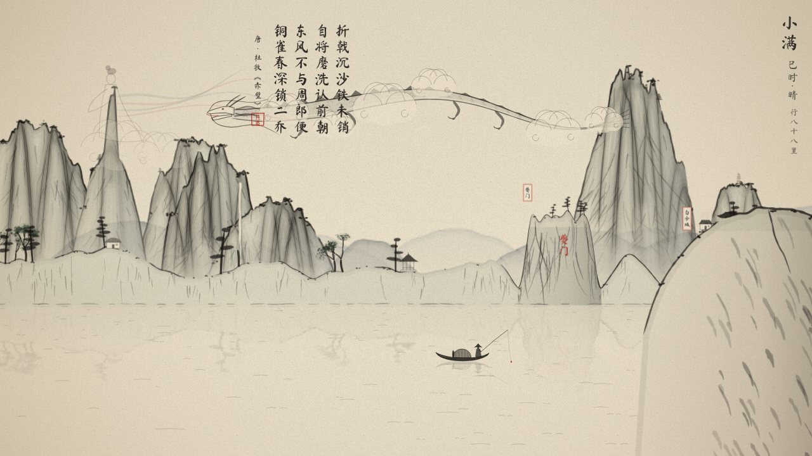

**此刻即卷首**：时辰、节气、月相从打开它的这一刻开始推移，一日约行千里——千里江陵一日还。

**垂钓**：停舟片刻，渔翁便下钩；浮标一沉，轻点江面起竿，按住收线、松手放线，别让线绷断。十六种长江鱼按季节、时辰、天气与江段出没，各有一幅水墨鱼谱；偶尔钓起旧草鞋、酒葫芦，或一张漂来的诗笺。钓得中华鲟，须放归长江。

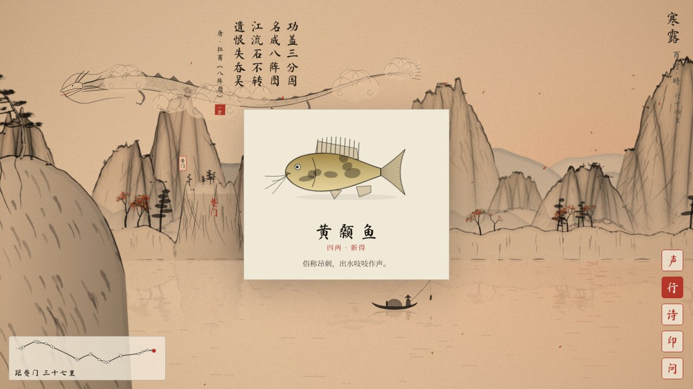

**诗囊**：一路所得的九十四首诗、鱼谱、行程与二十五方印都收在「囊」里，自动保存在本机浏览器中；未得之物会给出提示。另有几处不说破的秘密。

**操作**：拖动画卷 · 长按摇橹 · 点江面起涟漪或起竿 · 点天空惊起飞鸟 · 点小舟听渔歌 · 空格停舟 · ← / → 行舟与回看 · S 声音 · P 题诗 · B 诗囊 · 「印」钤印存图

## 芥子

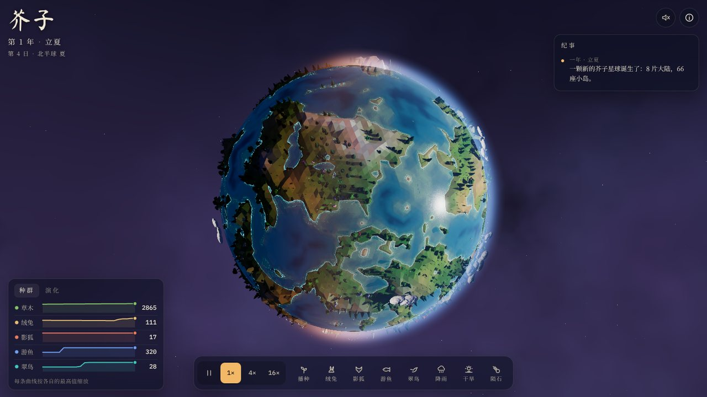

名字取自“芥子纳须弥”——一粒芥子里，装得下一座须弥山。

**星球**：低多边形的球体上有海洋、沙滩、山脉、湖泊与岛屿。地轴倾斜 26°，一年十二日，二十四节气轮转：雪线与海冰随季节进退，秋天树叶转黄；昼夜交替，夜侧的海岸泛起微光、萤火点点；有月亮、云影、风暴与雨。「换一颗星球」可随时生成一个全新的世界。

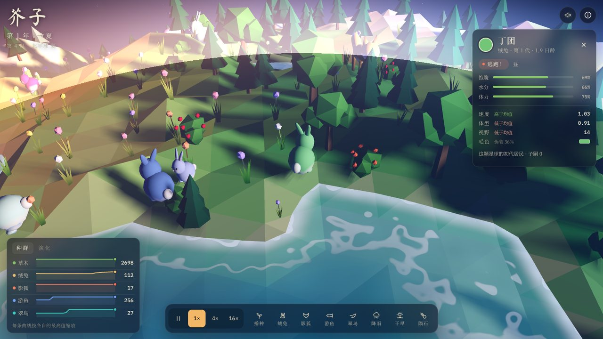

**生态**：五种植物——开花的草、浆果灌木、阔叶树、松、仙人掌——依雨水、日照、气温与土壤生长、播种、枯死。绒兔吃草，影狐追猎绒兔；它们要吃、要喝、要休息，会衰老、求偶、育幼。游鱼以海中的浮游生物为食，翠鸟俯冲捕鱼。捕食者与猎物的此消彼长全由规则自然生成，没有写好的剧本；某种动物一旦灭绝，过些日子会有迁入者。

**演化**：每只动物都带着速度、体型、视野、毛色四种基因，繁衍时交叉与突变。毛色越接近脚下土地的颜色越不容易被发现，所以过一段时间，种群的毛色和体格会慢慢改变——「演化」页里看得见毛色谱与基因均值的走向。

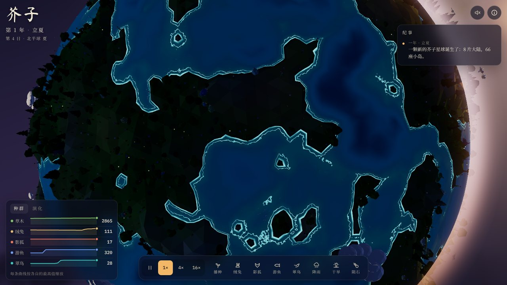

**玩法**：点任意一只动物即跟随它，卡片上有它的状态、饱腹、水分与体力、基因（与种群均值相比）、伪装程度、父母与子女；它死去时，可以改为跟随它的后代。八种工具：播种、绒兔、影狐、游鱼、翠鸟、降雨、干旱、陨石。时间可暂停或 1×、4×、16× 流逝。「纪事」记下世代更替、罕见毛色、繁盛与崩溃、灭绝与迁入，点一条即可跟随当事的动物。可选环境音。

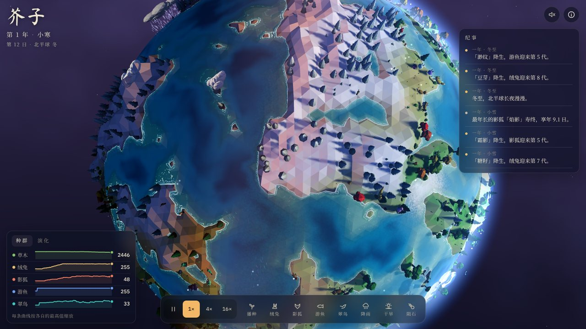

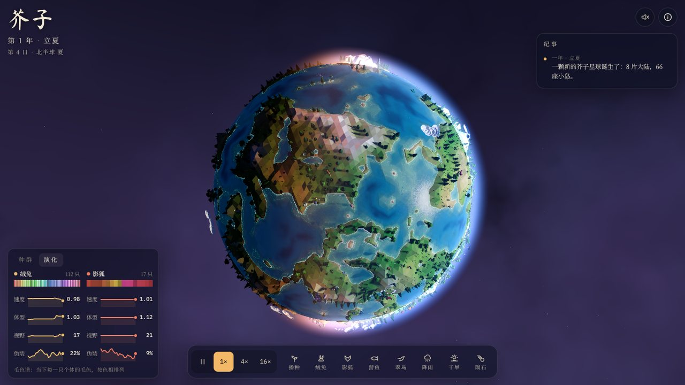

**操作**：拖动旋转 · 滚轮或双指缩放 · 点击动物跟随 · 选工具后点击星球施放 · 空格 暂停 · 1 / 2 / 3 切换 1× / 4× / 16× · Esc 取消

需要支持 WebGL 的浏览器；较弱的设备会自动降低画质。

## 舆图通鉴

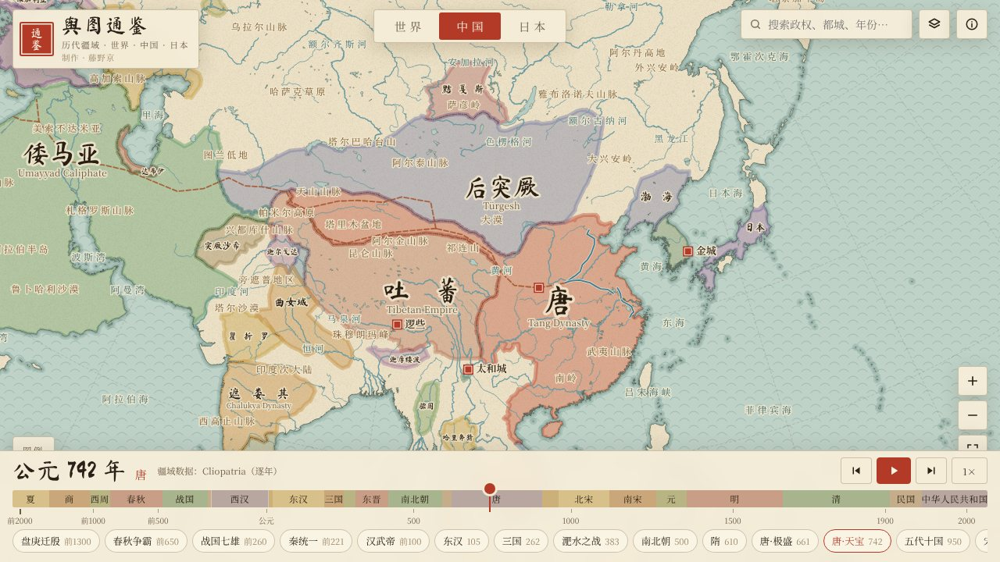

取“舆图”（地图）与“通鉴”（通贯古今）二义。拖动时间轴，世界、中国、日本的疆域逐年变化；每一处都可放大细看。

**三部图**

- **世界**：Cliopatria 的逐年政权疆域（前3400年至2024年），另可在「图层」里换成 historical-basemaps 的54个历史快照对照。
- **中国**：上古至今的历代疆域与都城，长城、隋唐与京杭大运河、丝绸之路、郑和航线、黄河夺淮故道；现代视图为省级与地级行政区，含南海断续线。
- **日本**：绳纹至令和——令制国、战国大名分国、江户街道与诸藩居城、明治府县的变迁、现代都道府县与市区町村。

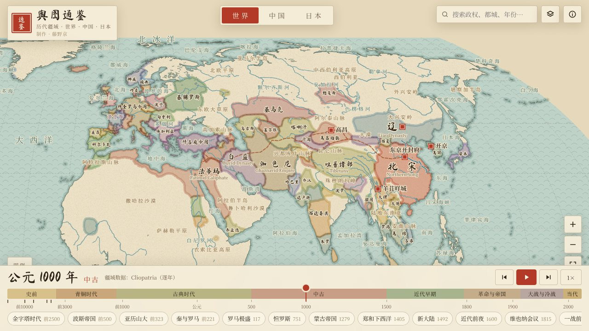

**精确，可缩放**：地图全部矢量绘制，滚轮、双指或右下角按钮缩放——世界视图最多放大约180倍，中国48倍，日本28倍；放大后自动换用更精细的数据，海岸线、岛屿与行政区界清晰可辨。点击任一政权或行政区可看说明。

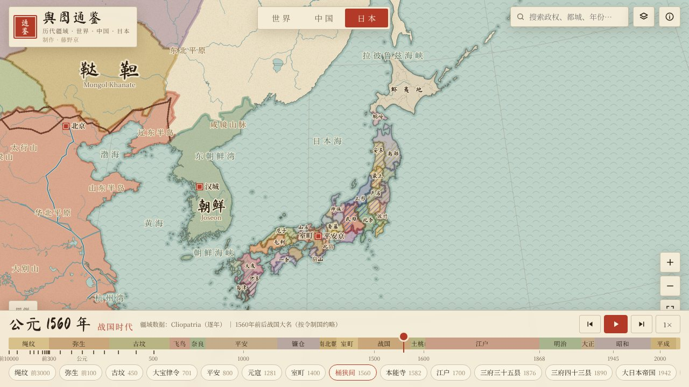

**时间轴**：逐年翻阅或自动播放，下方的时代签（盘庚迁殷、春秋争霸、战国七雄、淝水之战……）一点即到。可以搜索政权、都城与年份；在文件名后加上 `#china-742`、`#world-1914`、`#japan-1560` 之类的后缀，可直接打开某一年的某部图。

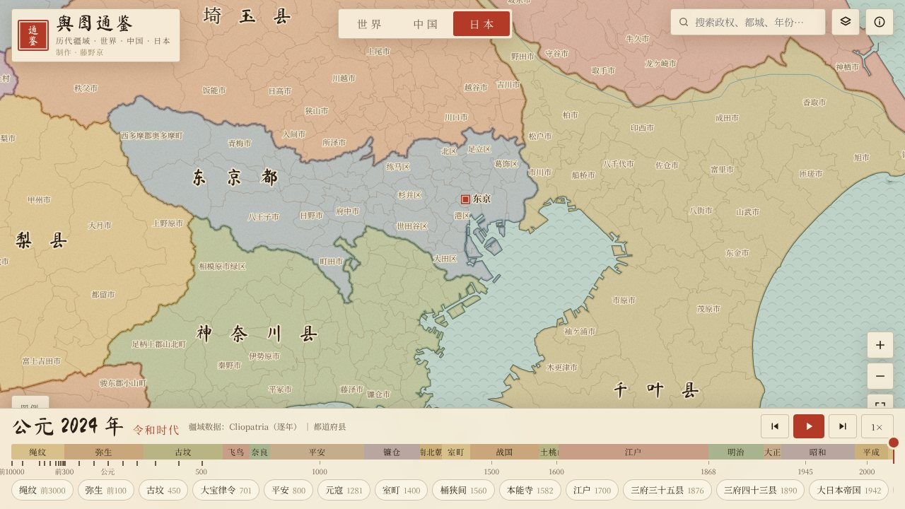

**操作**：拖动平移 · 滚轮、双指或右下按钮缩放 · ← / → 逐年 · 空格 播放/暂停 · / 搜索 · Esc 关闭

**说明**：历史疆域本身多有争议，图上边界均为近似，只示大势。北方四岛、竹岛（独岛）、钓鱼岛等争议岛屿按所用数据原样绘制，不代表对主权的立场。文件约 27 MB（内含全部地图数据），首次打开需要几秒钟解压。

## 怎么打开

- **下载即用**：在仓库里点开作品文件（如 `无尽藏.html`），点右上角的下载按钮（Download raw file），存到本地后双击打开；也可以在仓库首页 Code → Download ZIP 一次下载全部。
- **全部离线**：字体（已按所用字符精简）、程序与数据都已内嵌在文件里，断网也能完整运行。
- **文件大小**：无尽藏约 1.6 MB，芥子约 1 MB，舆图通鉴约 27 MB（内含全部地图数据）。
- **目录页**：根目录的 `index.html` 汇总了所有作品，需与作品文件放在同一文件夹。
- **浏览器**：推荐新版 Chrome / Edge / Safari / Firefox；芥子需要支持 WebGL。
- **网址访问（可选）**：在仓库 Settings → Pages 里选择 `main` 分支根目录，即可用 GitHub Pages 网址直接打开。

## 致谢与授权

- 《无尽藏》卷中九十四首诗文皆录自古人旧作（先秦至明清），卷首题辞出自苏轼《赤壁赋》，均属公有领域；山水、人物、鱼谱、印章皆由程序即时绘出，古琴、江声、钟声、鼓声由浏览器即时合成。
- 《芥子》的星球、草木与动物全由程序即时生成，生态与演化为程序模拟；三维渲染使用 three.js（MIT），已内嵌。
- 《舆图通鉴》的地图数据来自 Cliopatria（Seshat，CC BY 4.0）、historical-basemaps（GPL-3.0，由其派生的数据块同样以 GPL-3.0 分发）、Natural Earth（公有领域）、阿里云 DataV.GeoAtlas、日本国土交通省「国土数値情報（行政区域データ）」（经 SmartNews 媒体研究所 japan-topography 简化）与 ROIS-DS 人文学开放数据共同利用中心（CODH）。其中 CODH『旧国・旧郡境界データセット』为 CC BY-NC 4.0，**因此《舆图通鉴》仅供非商业用途**。逐项来源、许可与署名见 [舆图通鉴-数据来源.md](舆图通鉴-数据来源.md)。
- 程序库：d3（ISC）、topojson（ISC），已内嵌在《舆图通鉴》中。
- 字体：马善政毛笔楷书（Ma Shan Zheng）、思源宋体（Noto Serif SC）、思源黑体（Noto Sans SC）、站酷庆科黄油体（ZCOOL QingKe HuangYou）、IBM Plex Mono，均为 SIL Open Font License，已按所用字符精简后内嵌在各作品文件中（目录页的字体经 Google Fonts 加载）。
